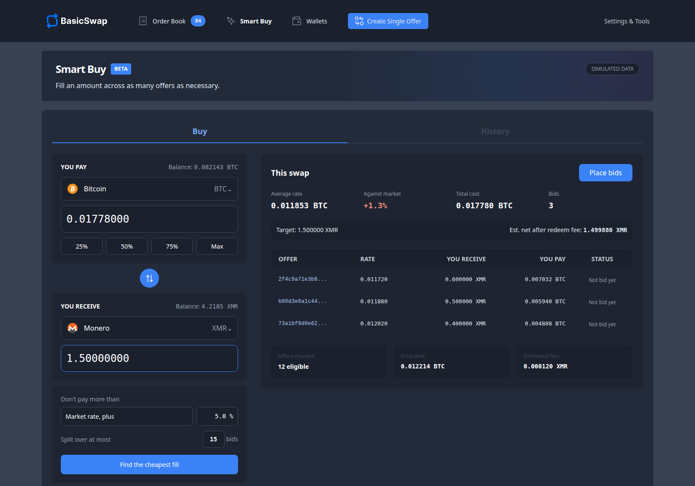

BasicSwap v0.19.0 begins the 0.19 series with a substantial update to how you plan and fund swaps and how peers communicate. Smart Buy arrives in beta to handle the offer-by-offer calculations for you, so you can enter how much you want to pay or receive and review the proposed bids before placing them. Corrected redeem fee estimates for Monero-family coins and reverse offers also give you a more accurate view of the expected cost when planning a buy spread across several offers.

On the messaging side, the new Networks tab brings SMSG, SimpleX, and the newly added Nostr transport into one settings page, while the default SimpleX Chat version moves to v7.0.0. Alongside these network changes, the release fixes how adaptor-signature swaps handle repeated accepts and assemble the separate messages that carry their proofs.

For existing installations, the release also updates Firo to v0.14.18.1 and upgrades a v0.18.10 installation's database from schema v38 to v40 on first startup.

## Most notable updates

### Smart Buy works through the offers for you

To start a Smart Buy, choose the coins you want to pay and receive, enter an amount on either side, and set the maximum number of bids you are willing to place. BasicSwap then compares eligible offers using their rates, minimum amounts, and estimated redeem fees, giving you a preview of the proposed bids and the estimated net amount you would receive ([PR #728](https://github.com/basicswap/basicswap/pull/728)).

<figure>
  
  <figcaption>A Smart Buy preview with simulated BTC-to-XMR offer data. No bids were placed.</figcaption>
</figure>

The price ceiling can follow the market rate or the best eligible offer, with defaults of up to 15 bids and a ceiling 5% above the market rate. If no market rate is available, that planning mode stops with an error, so you will need to use the best-offer anchor or pick offers manually to continue. Picking offers yourself bypasses the automatic price ceiling, so review their rates and the total before confirming ([backend commit `8449a18`](https://github.com/basicswap/basicswap/commit/8449a187), [interface commit `bf7f6ce`](https://github.com/basicswap/basicswap/commit/bf7f6ce7)).

After you place the bids, the bids page groups them under the same buy, while Smart Buy's History tab lets you return to earlier buys and retry a shortfall. Each bid still depends on its own counterparty and swap progress, so a failed bid does not roll back bids that were placed successfully ([PR #728](https://github.com/basicswap/basicswap/pull/728)).

<Callout type="info" title="Review the fill before placing bids">
Smart Buy is in beta, and the available offers may only fill part of your requested amount at your chosen limit. The preview shows that shortfall and warns when the planner reaches its search limit, since that result may not be the cheapest available combination. Check the estimated fees and net receive amount as well as the quoted rates before confirming.
</Callout>

### Funding several bids together

Placing several bids together also means preparing their funding without having them compete for the same wallet outputs. For a reverse adaptor-signature buy where the buyer funds separate chain-A locks, BasicSwap reserves distinct inputs for each bid where the coin supports input selection, splitting wallet outputs first if needed so the locks can be prepared together ([commit `f580f33`](https://github.com/basicswap/basicswap/commit/f580f33b)).

On supported coins, ready adaptor-signature bids in the same placement group can share one chain-B funding transaction, while secret-hash bids can share one participate transaction with a separate lock output for each swap. Since the bids will not necessarily become ready together, BasicSwap waits within bounded deadlines before allowing the ready bids to proceed, leaving slower bids to fund separately when needed. Where it can measure a lock's remaining window, it also checks that window before extending the wait ([commits `8449a18`](https://github.com/basicswap/basicswap/commit/8449a187), [`98d0661`](https://github.com/basicswap/basicswap/commit/98d0661f)).

Scripts can use the same planning and placement functions through `POST /json/bids/plan`, which returns a preview without placing bids, and `POST /json/bids/bulk`, which places the supplied bids and reports successes and failures separately. Bid listings include a `plan_id` for grouped bids and their stored `plan_target`, allowing a client to track a buy across retries ([API documentation](https://github.com/basicswap/basicswap/blob/v0.19.0/doc/api.md)).

### Nostr joins the message networks

Nostr can now carry BasicSwap offers, bids, and swap messages, either alongside the existing message networks or as your selected transport. Add it under **Settings > Networks**, or run `basicswap-prepare --datadir="$SWAP_DATADIR" --addnetwork=nostr` with your installation's data directory, then restart BasicSwap. The prepare command accepts `NOSTR_RELAYS` and `NOSTR_POW_TARGET` environment variables when you want to change its relay list or outgoing proof-of-work target ([PR #754](https://github.com/basicswap/basicswap/pull/754), [Nostr guide](https://github.com/basicswap/basicswap/blob/v0.19.0/doc/nostr.md)).

Bid and swap payloads retain BasicSwap's SMSG encryption, while each newly negotiated direct Nostr route gets its own signing key pair, separate from wallet keys and the persistent key used for broadcasts. Those separate keys reduce linkage between routes, but relays can still observe the outer signing key, message timing, and event size, and public offers remain readable to anyone with the shared BasicSwap network key. If you enable Tor in BasicSwap, Nostr uses the configured Tor proxy for its relay connections ([commit `669e182`](https://github.com/basicswap/basicswap/commit/669e1827)).

The Networks tab lets you enable or disable the configured transports, adjust Nostr and SimpleX settings, and enable optional network bridging for nodes that need to communicate across different transports. Adding a network through prepare keeps the others enabled, and the disable command refuses to remove the last enabled network; `/json/networks` also reports which networks are enabled and active ([PR #754](https://github.com/basicswap/basicswap/pull/754)).

<Callout type="info" title="Check your Nostr relay settings">
Use `wss://` relays, since plain `ws://` connections without a proxy expose relay traffic metadata on the wire and produce a warning. Outgoing proof of work and the incoming minimum are separate settings, both defaulting to zero; raising the incoming minimum can exclude ordinary BasicSwap peers whose events contain no proof of work. When using multiple networks, check that `smsg_payload_version` is 2 so BasicSwap can identify duplicate messages across transports.
</Callout>

### SimpleX Chat v7 and group changes

The SimpleX Chat default moves from v6.3.5 to v7.0.0, and newly prepared SimpleX configurations use the official BasicSwap group link unless you supply another one. Changing a recorded group link now causes BasicSwap to leave the existing groups and join the replacement on restart, while keeping direct contacts used for bid messages; if the node owns an existing group, it refuses the switch until you resolve that group in SimpleX Chat ([PR #753](https://github.com/basicswap/basicswap/pull/753)).

Existing installations need one restart before changing groups, because the first startup records the configured link if there is no joined link on file. The release also makes temporary send failures retryable when the `simplex-chat` client is unreachable, and corrects prepare's server-address setting to read `SIMPLEX_SERVER_ADDRESS`, which the older code mistakenly took from `SIMPLEX_CHAT_VERSION` ([commit `ed63285`](https://github.com/basicswap/basicswap/commit/ed632858)).

### Repeated accepts keep the same swap transactions

An adaptor-signature accept contains the lock transaction, refund transactions, and proof material that both peers need to agree on before the swap proceeds. BasicSwap now saves that prepared accept before sending it and reuses the saved contents on a retry, including for reverse bids, so a retry does not create a different lock transaction and proof for the same bid ([PR #749](https://github.com/basicswap/basicswap/pull/749)).

The separate proof messages now identify the parent message they complete when both peers support the updated protocol, so proof parts that name a different accept are excluded during assembly. While a bidder is still receiving an accept, it can replace that accept with a later one; for older peers whose proof messages lack a parent ID, BasicSwap uses send timestamps and requires the replacement to have been sent at least one second later. Once the bid advances beyond receiving the accept, this replacement rule no longer applies ([PR #746](https://github.com/basicswap/basicswap/pull/746), [PR #757](https://github.com/basicswap/basicswap/pull/757)).

### Redeem fees and Firo Core

Monero and Wownero redeem estimates now follow the configured wallet priority, using a tier-two estimate when the priority is automatic, since the wallet chooses its own rate for a sweep. Reverse offers also use the correct side of the offer when estimating the received coin's redeem fee, bringing that correction into both the offer page and Smart Buy's comparisons ([commit `36a1d82`](https://github.com/basicswap/basicswap/commit/36a1d824)).

Firo Core moves from v0.14.18.0 to v0.14.18.1, so include the core update step when upgrading an installation that uses BasicSwap-managed Firo binaries ([PR #756](https://github.com/basicswap/basicswap/pull/756)).

## Install the latest BasicSwap update

To install, [update BasicSwap through the usual process](/docs/user-guides/update) and relaunch.

<Callout type="info" title="What to expect on upgrade">
Back up your coindata directory before updating, since the first startup upgrades database schema v38 to v40. Include `--upgradecores` to fetch Firo Core v0.14.18.1 where BasicSwap manages that daemon, and review the new Networks tab after restarting. SimpleX Chat uses a separate preparation step, described below.
</Callout>

### Docker

If you installed BasicSwap with Docker:

1. From your BasicSwap repository's `docker` folder, stop the running container with `docker-compose stop`.
2. From that same folder, run `git pull`.
3. Run `docker-compose build --no-cache`.
4. Run `docker-compose run --rm swapclient basicswap-prepare --datadir=/coindata --upgradecores`.
5. When the core update finishes, launch BasicSwap again with `docker-compose up`.

Depending on your Docker version, the command may be `docker compose` without the dash.

### Non-Docker

If you installed BasicSwap without Docker, use the steps below and replace `$HOME/coinswaps` with your installation directory if it differs:

1. Shut down BasicSwap properly.
2. Run `export SWAP_DATADIR="$HOME/coinswaps"`.
3. Run `source "$SWAP_DATADIR/venv/bin/activate"`.
4. From `$SWAP_DATADIR/basicswap`, run `git pull`.
5. Run `pip3 install --require-hashes -r requirements.txt`.
6. Run `pip3 install .`.
7. Run `basicswap-prepare --datadir="$SWAP_DATADIR" --upgradecores`.
8. Launch BasicSwap as usual.

### Updating the SimpleX client

If you use SimpleX, stop BasicSwap and run `basicswap-prepare --datadir="$SWAP_DATADIR" --addnetwork=simplex` to prepare the v7.0.0 client; for Docker, run `docker-compose run --rm swapclient basicswap-prepare --datadir=/coindata --addnetwork=simplex` from the `docker` folder instead. Re-adding SimpleX applies the preparation defaults and any environment overrides, so set `SIMPLEX_GROUP_LINK`, `SIMPLEX_SERVER_ADDRESS`, and `SIMPLEX_WS_PORT` to your intended values if you use a custom configuration ([SimpleX guide](https://github.com/basicswap/basicswap/blob/v0.19.0/doc/simplex.md)).

<Callout type="info" title="SimpleX binary verification depends on the platform">
SimpleX Chat v7.0.0's signed checksum manifest covers the Ubuntu x86_64 builds, so BasicSwap's prepare step cannot verify its downloads for the other supported platforms. For those platforms, the SimpleX guide describes supplying your own binary at `bin/simplex/simplex-chat` and adding the network with `--nocores`, which skips BasicSwap's download and verification step. After preparing the client, restart BasicSwap and let that first startup record your existing group link before changing it.
</Callout>

### Install script

If you installed BasicSwap with [Nahuhh's GitHub installation script](https://github.com/nahuhh/basicswap-bash/), run `bsx-update`, then check the SimpleX client steps above if you use that network.

## Changelog

The v0.19.0 changelog, grouped by area.

### Smart Buy and batched funding

* Add the buy planner, bulk-bid API, and grouped chain-B funding [[`8449a18`](https://github.com/basicswap/basicswap/commit/8449a187)] / [PR #728](https://github.com/basicswap/basicswap/pull/728)
* Reserve distinct inputs for reverse-bid locks and split wallet outputs when needed [[`f580f33`](https://github.com/basicswap/basicswap/commit/f580f33b)]
* Batch ready secret-hash participate outputs in one funding transaction [[`98d0661`](https://github.com/basicswap/basicswap/commit/98d0661f)]
* Add the Smart Buy page, grouped bids, and buy history [[`bf7f6ce`](https://github.com/basicswap/basicswap/commit/bf7f6ce7)]

### Message networks

* Add Nostr transport, route signing keys, relay controls, and the Networks settings tab [[`669e182`](https://github.com/basicswap/basicswap/commit/669e1827)] / [PR #754](https://github.com/basicswap/basicswap/pull/754)
* Update SimpleX Chat defaults to v7.0.0, handle group-link changes, retry temporary client send failures, and correct the server-address environment variable [[`ed63285`](https://github.com/basicswap/basicswap/commit/ed632858)] / [PR #753](https://github.com/basicswap/basicswap/pull/753)
* Refactor release preparation into reusable coin and network modules [[`d1853b0`](https://github.com/basicswap/basicswap/commit/d1853b02)] / [PR #752](https://github.com/basicswap/basicswap/pull/752)

### Swap accepts and fee estimates

* Save prepared adaptor-signature accepts before sending and reuse them on retries [[`93ff612`](https://github.com/basicswap/basicswap/commit/93ff6127)] / [PR #749](https://github.com/basicswap/basicswap/pull/749)
* Associate split proof messages with their parent message while keeping older-protocol compatibility [[`6ad36ee`](https://github.com/basicswap/basicswap/commit/6ad36eee)] [[`1ec8939`](https://github.com/basicswap/basicswap/commit/1ec89396)] / [PR #746](https://github.com/basicswap/basicswap/pull/746)
* Accept a later adaptor-signature accept while still receiving the earlier one, with timestamp rules for older peers [[`087ce4c`](https://github.com/basicswap/basicswap/commit/087ce4c8)] [[`331e89f`](https://github.com/basicswap/basicswap/commit/331e89fe)] / [PR #757](https://github.com/basicswap/basicswap/pull/757)
* Correct Monero-family and reverse-offer redeem fee estimates [[`36a1d82`](https://github.com/basicswap/basicswap/commit/36a1d824)]

### Versions and tests

* Update Firo Core to v0.14.18.1 [[`fe1353c`](https://github.com/basicswap/basicswap/commit/fe1353c8)] / [PR #756](https://github.com/basicswap/basicswap/pull/756)
* Raise the GUI version to v4.1.0 [[`f74be67`](https://github.com/basicswap/basicswap/commit/f74be678)]
* Add tests for repeated accepts, batched bids, partial in-flight funding, and mixed message networks [[`b930849`](https://github.com/basicswap/basicswap/commit/b930849d)] [[`6f5d21e`](https://github.com/basicswap/basicswap/commit/6f5d21e6)] [[`ddce922`](https://github.com/basicswap/basicswap/commit/ddce9221)] [[`535ba40`](https://github.com/basicswap/basicswap/commit/535ba408)] [[`669e182`](https://github.com/basicswap/basicswap/commit/669e1827)]

You can inspect every change on the [v0.18.10 to v0.19.0 comparison page](https://github.com/basicswap/basicswap/compare/v0.18.10...v0.19.0).

## Stay connected

Keep up with BasicSwap on social media:

- **Twitter:** [@basicswapdex](https://twitter.com/basicswapdex)
- **Matrix:** [BasicSwap channel](https://matrix.to/#/#basicswap:matrix.org)
- **GitHub:** [BasicSwap repositories](https://github.com/basicswap)
- **Support the project:** [Donation page](https://basicswapdex.com/donations)
