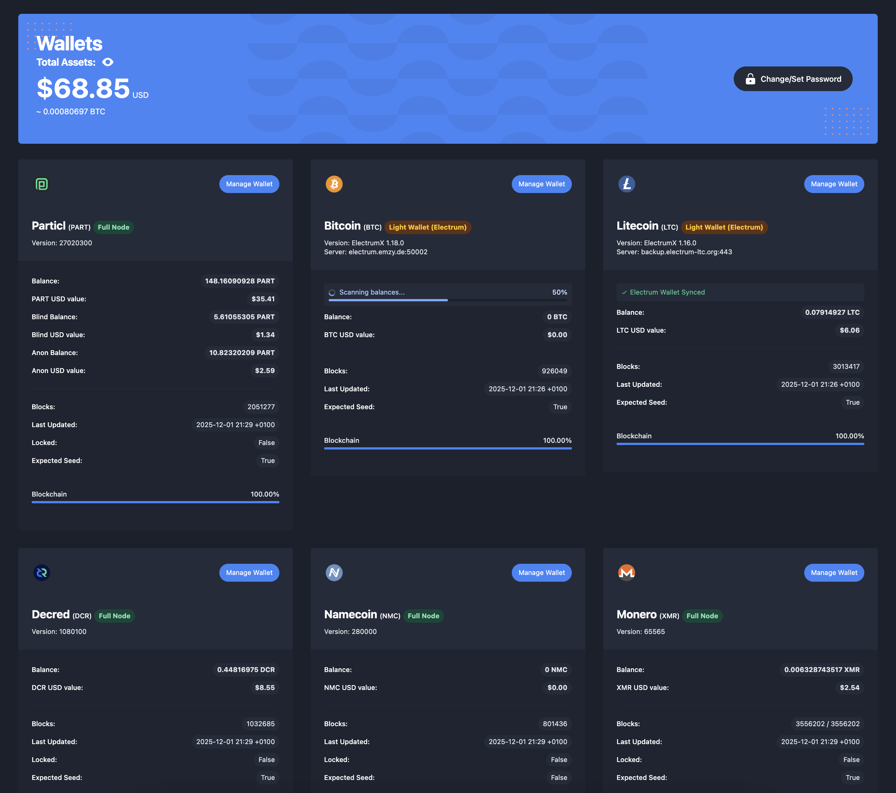

It's been a while since we've updated the community about what's going on with BasicSwap, and with the month of November 2025 now behind us, let's take a look at what we've accomplished and the large amount of work we're currently focused on.

## What We're Working On

Back in October, we released both BasicSwap version 0.15.0 and 0.15.1, which focused mostly on stability and performance improvements. Key improvements include the ability to execute cross-network swaps via BasicSwap's multi-net support, the separation of SMSG and Particl Core, allowing you to run SMSG without a Particl node, and various other quality-of-life improvements that we'll go over in this update. numerous bug fixes. 

<UrlPreviewCard url="/blog/basicswap-release-v015_1" />
<UrlPreviewCard url="/blog/basicswap-release-v015" />

Additionally, we have begun and made significant progress on BasicSwap's portability capabilities and pre-signing of swap transactions to make it deployable on the web or on mobile applications, along with the implementation of light wallets for a select number of coins (no need to run full cores for these coins anymore).

On the GUI front, we have continued working on the revamped order book designed to mirror the look and feel of traditional centralized exchanges, with integrations for the AMM functionality and quick swaps (taker) directly into it.

<Callout type="info" title="This Month — A Bird's Eye View">
  <ul>
    <li>
      <strong>Major Features Being Looked Into:</strong>
      <ul>
        <li>Light Wallet Support (SPV) for Bitcoin, Litecoin, Firo, Dash, Doge, and Bitcoin Cash</li>
        <li>Pre-signed swap transactions</li>
        <li>Web and mobile-friendly framework</li>
        <li>Advanced order book design and functionalities, with quick swaps and AMM integrations</li>
      </ul>
    </li>
    <li>
      <strong>Key Improvements:</strong>
      <ul>
        <li>Ability to integrate BasicSwap on the web or mobile with minimal compromises</li>
        <li>Ability to deploy BasicSwap locally without having to run full coin nodes, saving massively on storage space and setup time</li>
        <li>More reliable network offers</li>
        <li>Less setup friction and more accessibility to reach more users</li>
      </ul>
    </li>
  </ul>
</Callout>

### Upcoming Milestones (Short-term Roadmap)
Here's an updated look at our short-term roadmap, representing the next major milestones in approximate order of development. As BasicSwap DEX is a complex project with multiple moving parts, we may adjust the roadmap to better reflect the platform's evolving priorities.

<Timeline items={[
  { status: 'In Production', title: 'Multi-Net Functionality', description: 'Enables BasicSwap to distribute swap, offer, and bid messages across multiple messaging networks beyond SMSG when the primary network experiences high load. Now includes cross-network swaps when two users operating on different data network want to swap together.', long_description: 'Currently live on the main branch, but it does not possess all the bells and whistles we have planned for its official V1 version.\n\nNamely, it is currently not included in the GUI and it must be manually configured outside the user interface by editing a config file. The team will not offer support for this feature until the integration is ready for the public with a proper GUI and set of documentations.' },
  { status: 'In Production', title: 'AMM and Advanced Order MGMT', description: 'Enables advanced trading operations like automated market making and advanced order/bid placement.', long_description: 'As it stands at this moment, the initial implementation is now ready and live on the dev branch, and a new BasicSwap page connects directly with the automated market making companion script, allowing you to interact with it directly from the user interface.\n\nThis means you can deploy it, edit its configuration, and post offers using advanced trading options — such as automatic republishing, automatic fiat spread adjustment, price pegging, and more — straight from the user interface.' },
  { status: 'In Testing', title: 'Light Wallet Support (SPV)', description: 'Enables users to use light wallets instead of full nodes for faster setup time and reduced storage requirements.', long_description: 'This feature has now been implemented for Litecoin and is currently in testing. Once fully working, implementing light nodes for Bitcoin, Bitcoin Cash, Firo, Dash, and Dogecoin will be trivial and should take little time.' },
  { status: 'Planned', title: 'Pre-signed Swap Transactions', description: 'Enables users to safely go offline once a swap is initiated without disrupting the swap process.', long_description: '' },
  { status: 'In Progress', title: 'Web and Mobile Framework', description: 'Enables BasicSwap to be deployed on web and mobile platforms with minimal compromises.', long_description: 'Making BasicSwap web and mobile friendly is a large undertaking that requires refactoring several components. Ultimately, it is vital in acquiring a larger user base, which will naturally lead to greater liquidity and better volume on the DEX.\n\nThis task is currently in progress and constitutes one of our primary focus at this moment.' },
  { status: 'Planned', title: 'Quicks Swaps', description: 'Improves and simplifies the process of posting a new offer.', long_description: 'Posting a new offer to the order book is a cumbersome, multi-step process that has remained virtually untouched since the initial BasicSwap GUI release.\n\nThe new "Quick Swaps" feature streamlines this experience, allowing users to post offers from a single, intuitive window without navigating through multiple pages.\n\nImproving this core function is vital for making the DEX more intuitive and will integrate seamlessly with the upcoming order book redesign.'},
  { status: 'In Progress', title: 'Advanced Order Book Design', description: 'Redesign of the order book into a more intuitive and user-friendly interface.', long_description: 'The current BasicSwap order book functions more like an over-the-counter (OTC) offer board than a traditional order book found on major exchanges like Binance.\n\nWhile this isn\'t inherently bad, it doesn\'t align with our mission to make atomic swaps a ubiquitous and viable alternative to high-risk centralized exchanges (CEXs).\n\nTo address this, we are redesigning the order book to be more intuitive and to include features users expect, such as a depth chart, volume indicators, separate buy/sell books, and market order capabilities.\n\nUltimately, our goal is to deliver the security and privacy benefits of adaptor signature atomic swaps within a DEX that has the familiar look and feel of a popular exchange, but without the associated centralized risks.' },
]} />

## Changes Since Last Update

What follows are all the published changes since our last update. Note that this isn't an exhaustive list of all the code we've worked on, as a good portion of it is still unpublished as we're still in the early stages of development.

### Coin(s)

*   Dash — Upgraded Dash Core to version 22.1.3
*   Firo — Upgraded Firo Core to version 0.14.14.3 (emergency release)
*   Firo — Upgraded Firo Core to version 0.14.15.0 (hardfork release)
*   Monero — Upgraded Monero daemon to version 0.18.4.3
*   Monero — Add request-sent, idle, and output distribution to transient errors for better error handling
*   Monero — Retry on transient error to improve swap reliability
*   Monero —  Remove `--non-interactive` flag (doesn't have any functionality on wallet)
*   Wownero — Coins now unlock after 4 confirmations instead of 3
*   Wownero — Reuse `threadPollXMRChainstate` & `monerod_proxy_config` for better efficiency
*   Bitcoin — Grind for low-r value signatures to match Bitcoin Core behavior
*   Particl — Updated Particl Core to version 27.2.2.0 (fixes ZMQ missing curve functions and `signmessage` for v23)
*   Particl — Keep compatible with Particl 23.2.7
*   Particl — Added `deprecatedrpc` line to `particl.conf`
*   Particl — Explicitly set `messagemagic` string for Particl v27

### AMM (Automated Market Maker)

*   AMM bug fixes for improved stability
*   Use float for `amount_step` instead of string to fix type errors
*   Icon beside amount & consistent size of add/edit buttons for better UI consistency
*   Use same rates for buying and selling to fix rate parity issues

### Network & SMSG (Multi-Net Support)

*   Add network portals to allow swaps between users on different networks
*   Manage SMSG pubkeys within BasicSwap instead of Particl Core
*   Store pubkeys in BSX if possible
*   Automatically set direct simplex mode per bid
*   Fix `add_to_outbox` parameter
*   Add network portal data to database
*   Add `message_nets` field to bids and offers
*   Don't raise an error if multiple networks are active (for testing)
*   Rename `smsg_plaintext_version` for clarity
*   Set `smsg_payload_version` automatically if unset
*   Make backwards compatible with smsg payload version 1
*   Enable network logging category in prepare script
*   Fix selection when no networks are specified
*   Fix `verifyMessage` parameter order
*   Add `ttl` parameter to `smsgEncrypt`

### ZMQ

*   Remove `time.sleep(0.1)` for improved performance
*   Use `recv_multipart` and set server keypair in prepare script
*   Use persistent client keypair for better connection stability
*   Fix default ZMQ configuration
*   Use ZMQ for Particl Core balances in the GUI

### UI Code & Experience

*   GUI version 3.3.1
*   Dynamic balances using WebSockets — balances now update in real-time without page refresh
*   Better notifications system using Toasts for more dynamic and useful GUI notifications
*   Updated toasts and added notifications history page
*   Fixed identity tooltips on bids page
*   Removed bottleneck on offers page for better performance
*   Major refactor and optimizations for improved memory efficiency
*   Fix pricechart display when no price/historical data is available
*   Fix getwalletinfo + various fixes
*   Fix WebSockets connection stability to keep connections alive
*   Removed CryptoCompare dependency + Added background thread for price fetching
*   Fix small bug with changepassword required
*   Show notification when new release of BSX is available
*   Fix BTC chart loading even if BTC is not enabled
*   Lint: eslints code quality improvements
*   BasicSwap version update notification bug fix
*   Updated Monero icon
*   Uniform padding on coin icons 
*   Clarify `LOCK_TX_A_REFUND` event descriptions

### Core Functionality

*   Change default key derivation paths — allows users to import keys generated on BasicSwap into Electrum (only applies when using descriptor wallets)
*   Fix rate tolerance calculations
*   Fix Simplex SQLite duplicate server entries
*   Allow relative paths in inputs for better flexibility
*   Allow `lock-tx nLockTime` to be > `chain height + 2`
*   Fix `force_db_upgrade` setting
*   Fix backwards compatibility with older SMSG payload versions
*   Timeout bids before the script coin lock tx is mined to prevent stuck swaps
*   Backports from upstream improvements
*   Adjust daemon startup log timing and types for better debugging
*   Reuse Particl daemon when adding coins to improve efficiency
*   Remove default values occluding error in scripts for better error reporting
*   Refactor: remove unused code for cleaner codebase
*   Refactor: deduplicate threads array
*   Add an env var to switch core repositories in prepare script

### Automation

*   Set max concurrent incoming bids to 1 as a strategy improvement

### Development

*   Add pre-commit hooks to ensure code quality

### Dependencies

*   Bumped `python-gnupg` from 0.5.4 to 0.5.5
*   Bumped `websocket-client` from 1.8.0 to 1.9.0
*   Bumped `black` from 25.1.0 to 25.9.0
*   Bumped `guix` packed version
*   Bumped `black` from 25.9.0 to 25.11.0
*   Add `zeromq` to Mac dependencies

### Tests

*   Disable checking for updates in tests
*   Updated `test_settings.py`

### Build

*   Raise version to 0.15.0
*   Update `guix` packed version
*   Raise version to 0.15.1
*   ci: Don't run on documentation updates

---

## Stay Connected

Stay connected with us on our social media channels for real-time updates, news, and more.

- **Twitter:** [@basicswapdex](https://twitter.com/basicswapdex)
- **Matrix:** [BasicSwap channel](https://matrix.to/#/#basicswap:matrix.org)
- **GitHub:** [BasicSwap repositories](https://github.com/basicswap)
- **Support the project:** [Donation page](https://basicswapdex.com/donations)
