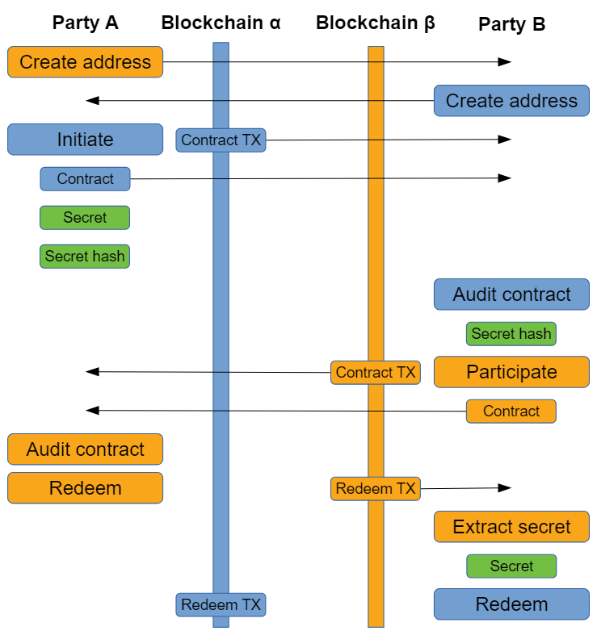
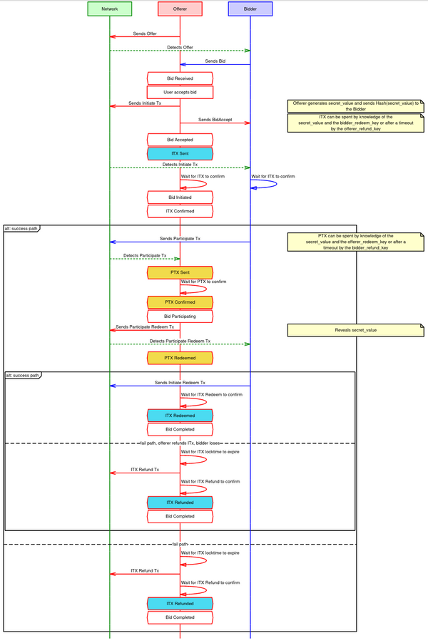

People keeping tabs on the ongoing beta of the open source BasicSwap DEX protocol may have noticed some mentions of two different kinds of cross-chain atomic swaps, namely “adaptor sig” swaps and “secret hash” swaps.

This article will explore the distinctions between the two kinds of swaps, their differences, and how the BasicSwap protocol leverages both to offer a truly decentralized and remarkably private basis for decentralized exchanges.

## What is an Atomic Swap?

An atomic swap, simply speaking, is a type of contract that enables a decentralized cryptocurrency transaction. “Atomic”, in this case, implies that the change of ownership of one asset should effectively imply the change of ownership of the other. First conceptualized in 2013 by [TierNolan on the Bitcointalk forums](https://bitcointalk.org/index.php?topic=193281.msg2003765#msg2003765), this first iteration of the concept, involving HTLCs (Hashed Time Lock Contracts), would need four more years to finally see the light of day.

Atomic swaps must involve two parties - as such, no third party or outside middleman can interrupt or interfere with the transaction. This characteristic means they are decentralized by nature and effectively immune to censorship, and as such are used in several decentralized exchanges, such as BasicSwap DEX and others.

In the BasicSwap application, nearly all of the steps involved in both types of swaps happen seamlessly, at the back-end level. Furthermore, the initial agreement on the amounts and assets involved in any given swap between two parties is handled by its entirely distributed order book, powered by Particl's own encrypted mixnet, the SMSG network.

## The Original: Hashed Time Lock Contract (“Secret Hash”) Atomic Swaps

The first successful implementation of atomic swaps came [from the Decred project](https://github.com/decred/atomicswap), leveraging "hashlocks" and "timelocks", with the help of on-chain scripts (or smart contracts), to accomplish the atomic swap conceptualized by TierNolan years earlier. We refer to this type of swap as a "secret hash" swap, or HTLC swap.

Technically speaking, the HTLC feature allows two users to conduct time-bound cryptocurrency transactions. This is highly relevant to this first implementation of atomic swap technology, as the recipient must submit a cryptographic proof (the “secret”) to the contract **within a set timeframe** (established in number of blocks, or block height), or else the funds will be returned to the sender. If the recipient acknowledges the payment, the transaction is successful. This, as it happens, requires both participating blockchains to have both **Hashlock** and **Timelock** capabilities - a condition that leaves out certain blockchains, such as the notoriously rigid and hyper-private Monero blockchain.

These two key concepts may be summarized in the following way:

| Concept | Description |
|---|---|
| A hashlock | is a function of certain blockchains that restricts the spending of funds until a certain piece of data is publicly disclosed (such as a cryptographic proof, in the form of a hash). |
| A timelock | is a function that restricts the spending of funds until a specific time (or block height) in the future. This ensures that the transaction occurs within a given timeframe, and returns funds to the depositor if it is not completed, without a need for a third party adjudicator. |

The graph below, sourced from Decred's implementation of atomic swaps, provides a visual representation of the steps and necessary transfers of data that each party performs:

In other words, HTLC-based atomic swaps work as follows:

Alice and Bob must first agree on the amounts and assets (e.g. Bitcoin and Ether) to exchange. Alice then generates a random secret, s, and uses a cryptographic hash function to generate hash, h. She then creates an HTLC contract using h, which locks up the Bitcoin. These coins can either be redeemed (spent) using the secret s, or they will be returned to her after a certain amount of time, t, has passed. Bob does the same thing with his Ether on the other chain, locking it up in an HTLC using the same hash, h. Since Alice knows the original secret, s, which was used to produce the hash, h, she can redeem the Ether from Bob's HTLC. By doing so she reveals the secret s to Bob, who can then take the Bitcoin and complete the swap.

Without diving too deep into the back-end inputs necessary to achieve a successful HTLC swap as described in the graph above, **the "secret hash" involved in them is the reason why HTLC swaps are sometimes referred to as "Secret Hash swaps"**. For the curious, more extensive documentation on the scripts involved in secret hash swaps is available on the [Decred atomic swap github page](https://github.com/decred/atomicswap).

### Some Shortcomings of Secret Hash Atomic Swaps

Although they are a remarkable breakthrough in the space of **decentralized** exchange technologies, "secret hash" atomic swaps are not perfect: these atomic swap transactions, and thus, their associated data as well, take place **on-chain**, which has privacy implications that are particularly relevant to BasicSwap.

Whenever a swap occurs, an identical hashed value will appear on both blockchains within a few blocks of each other — meaning that any moderately sophisticated passive observer of the two chains can easily link the coins involved in the swap, by finding identical hashes in blocks close to each other, timestamp-wise. When the coins are tracked across chains, the provenance is easily established. Although there is no associated identity data revealed from such an analysis, **it can potentially be trivial for third-parties to infer the identity of the participants involved**.

## The Latest: Adaptor Signature (“Scriptless”) Atomic Swaps

The second type of atomic swap available on BasicSwap, dubbed "adaptor sig" swaps, is based on the work of Monero developer Joël "h4sh3d" Gugger, in a Sept. 2020 paper titled []"Bitcoin–Monero Cross-chain Atomic Swap"](https://eprint.iacr.org/2020/1126). H4sh3d’s work can be said to be an implementation of [Lloyd Fournier’s work](https://github.com/LLFourn/one-time-VES/blob/master/main.pdf) on One-Time Verifiably Encrypted Signatures, A.K.A. Adaptor Signatures.

This type of swap is by necessity fundamentally different from HTLCs, because it is impossible for an XMR output to have an associated script. Therefore, a different method, which relies in part on necessary prerequisites provided by the non-XMR party, needs to be used to create the lock transaction. Note that these prerequisites are such that the initiating party of the “adaptor sig” swap protocol is only compatible with cryptocurrencies which use a bitcoin-style decentralized [UTXO model](https://en.wikipedia.org/wiki/Unspent_transaction_output), and that have Segwit or a Segwit-equivalent [malleability fix](https://en.bitcoin.it/wiki/Transaction_malleability), such as Litecoin.

Those "scriptless" swaps rely on a cryptographic technology known as an "adaptor signature". In essence, without going too deep into the origins and underlying math behind the technology, an adaptor signature is an **additional** signature that is combined with an initial signature to reveal a secret piece of data. Adaptor signatures enable two parties to reveal **two pieces of data** to each other simultaneously, and are the key building block of the kind of scriptless protocols that render XMR atomic swap pairs possible.

### How Does It Work?

This part of the article is particularly technical, but can shed some light on the privacy distinctions between both swaps.

The graph below provides a visual representation of the steps and necessary transfers of data that each party performs in an adaptor signature-based swap on BSX, from the offerer’s perspective. The green communication layer, in the case of BasicSwap, is handled by the SMSG network:

In other words, adaptor signature-based atomic swaps work as follows:

Alice and Bob must first agree on the amounts and assets (e.g. BTC and XMR) to exchange. Just like in the case of “secret hash” swaps, this is achieved in a private and decentralized way in BasicSwap via its distributed order book.

Note that a property of Monero is that **the sum of public keys will match the public key for the sum of private keys**. By sending XMR to the sum of the public keys they chose, Alice and Bob can create a lock tx similar to those used in the HLTC protocol.

**The basic idea is:**

* Alice and Bob each pick two secret (ECC) private keys (BTC and XMR), and swap one set of public keys with each other. Here, three different keys are involved for each side.
* Alice sends a BTC transaction with an output to a multisig output, which requires a signature from both Alice and Bob in order to spend it. Once that occurs, Bob sees the BTC tx and sends the XMR tx to the XMR public key sum, as mentioned above.
* Alice signs for her private key and encumbers that signature with Bob's xmr_public_key.
* She sends that adaptor signature to Bob. This adaptor signature is not a transaction signature, so the transaction cannot be spent yet, but it does commit to a secret value (Alice’s private key).
* Bob then decodes the adaptor signature with his xmr_private key and then signs for the BTC lock tx with his btc_private key.
* As Bob now has a valid signature from Alice and himself, he can now spend from the locked BTC tx.
* Alice watches the BTC chain for the tx that spends the lock tx. With Bob's signature, which is broadcast publicly on the Bitcoin side once the Bitcoin locked transaction is redeemed, she can recover Bob's xmr_private key.
* Alice, now endowed with both her and Bob's xmr_private keys, can spend from the XMR lock transaction, concluding the exchange.

### Some Advantages of Adaptor Signature Swaps

Atomic swaps using adaptor signatures have several advantages over traditional atomic swaps involving HTLCs.

The first thing to understand is that the adaptor signature swap scheme replaces the on-chain scripts, involving timelocks and hashlocks, on which “secret hash” swaps rely on. In other words, the secret and secret-hash in a HTLC swap (as detailed in the first graph) have **no immediate parallel** in adaptor sig swaps. This particularity of adaptor signature technology is why their implementations are sometimes referred to as **"scriptless scripts"** within the Bitcoin research community.

Since no such script is involved, the **on-chain footprint is reduced**, which has the non-negligible advantage of making the atomic swap more lightweight, and therefore cheaper.

Furthermore, contrary to HTLCs where the same hash has to be used on each chain, transactions involved in an atomic swap using adaptor signatures cannot be linked. This, again, is particularly relevant to BasicSwap’s privacy considerations, granted that **at least one of the two coins involved in the cross-chain swaps fulfills the prerequisites mentioned in the second paragraph of this article**.

### The Path Ahead for BSX: Two-Way Adaptor Signature Setup

Because scripts are not possible on blockchains like XMR, there are currently constraints on which coin can initiate a swap on BSX. To trade Monero for Bitcoin, for example, only the BTC-owning side can *initiate* a transaction.

Yet, because advance planning can be done consistent with atomic swapping, it is conceptually possible for both sides to effectively originate a swap:

If I have XMR and want, say, BTC, one could simply post **a desire to do a trade as their offer**. The BTC owner could then initiate the current, more formal process, still risk free. This process can be automated and be all but invisible to the front-end user experience, and is a major and very exciting upcoming item on the BSX roadmap.

## To Conclude…

The objective of this article is to provide a moderate but somewhat accessible understanding of **why** adaptor signature swaps can said to be a more private alternative to HTLC swaps, and how it protects swappers from any sort of malicious passive observance by achieving the necessary smart contract logic for an atomic swap, without the use of on-chain script or hashed secrets.

As always, if you care about privacy as we do, we invite you to spread the word about BasicSwap’s ongoing open beta. It is free to use, open source, does not rely on native tokens, and involves absolutely no KYC or account requirements — this arrangement offers only advantages for both you and the networks of the coins you’re trading.

Every little bit helps, and we can all be a big part of this fight for our freedoms and privacy. Even if this seems like a small step to you, bringing even one person to trade their privacy coins on a decentralized exchange like BSX can have a profound impact!

---

## Stay Connected

Stay connected with us on our social media channels for real-time updates, news, and more.

- **Twitter:** [@basicswapdex](https://twitter.com/basicswapdex)
- **Matrix:** [BasicSwap channel](https://matrix.to/#/#basicswap:matrix.org)
- **GitHub:** [BasicSwap repositories](https://github.com/basicswap)
- **Support the project:** [Donation page](https://basicswapdex.com/donations)
