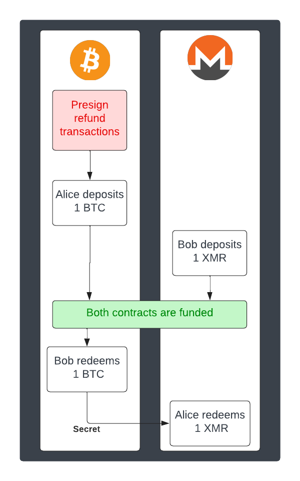

DEXs, or "decentralized exchanges", are becoming an increasingly attractive alternative to centralized exchanges in cryptocurrency trades. The spectacular failures of some centralized exchanges, like the Celsius debacle or last winter’s implosion of the FTX exchange where billions of dollars of customer’s funds were stolen obviously does nothing to help this climate.

There is, at the heart of the CEX vs DEX dynamic, a fundamental divide; while big centralized entities suit traditional market logic, and can adapt these principles to fuel their own growth, they go against the fundamental principle of blockchain and cryptocurrency itself: private, peer-to-peer money.

## A Path Ahead

It could be argued that atomic swaps represent the most decentralized, potentially most private way to exchange cryptocurrencies. They are, of course, extremely resilient — as long as the blockchain accepts your transaction and you have a reliable, hopefully private way to communicate with the other person, you can swap. This, in effect, makes them exactly as decentralized as the blockchains involved. It also opens the door to entirely eliminating trust from the process, unlike centralized models where you have to trust entities such as Binance, Celsius or FTX, and give them full control of your keys.

It was the Decred team who [first made this technology a practical reality](https://github.com/decred/atomicswap), with their implementation of the first HTLC-based atomic swaps. At their core, HTLC swaps are easy to understand. They involve 'Hashed Timelock Contracts', which are types of smart contracts, on both the buyer and seller sides. **This means that both blockchains must have Timelock and Hashlock capabilities.**

Besides this limiting requirement, the HTLC swap also lacks privacy. While it allows for trustless, atomic swap exchanges to exist, it also creates a new problem with it: when making a swap, a secret is created, hashed out, and inscribed, minutes apart, in the blockchains of both participating blockchains. The problem here is that while this allows the protocol to verify the transaction and move through the next steps of a swap, it also makes it trivial for outside observers to infer the two participants of a swap, as well as what amount of money is being exchanged. Here, an important privacy issue must be addressed.

### Point Time Locked Contract Swaps and Adaptor Signatures

An important stepping stone to making atomic swaps the trustless, decentralized and hyper-private powerhouse that it can be lays in adaptor signatures.

As we explored in this piece, the adaptor signature atomic swap scheme, otherwise referable to as "Point Time Locked Contract (PTLC) swaps, begins with Andrew Poelstra’s work on scriptless scripts. Poelstra’s work was born out of necessity to interact with MimbleWimble, an extremely rigid blockchain protocol. These scriptless scripts exploit the linear nature of [Schnorr signatures](https://tlu.tarilabs.com/cryptography/introduction-schnorr-signatures): by using Schnorr signatures in clever ways that are expanded further in this article, or in greater technical detail [here](https://hongchao.me/scriptless-script/).

Poelstra’s work, in any case, makes it possible to replicate certain smart contract capabilities without needing any of the actual smart contract language a given coin may have. The adaptor signature swap, as such, is an example of a scriptless script.

However, and this is important, Bitcoin and Monero do not use Schnorr signatures in its cryptographic signature algorithm — instead, they use a classic **Elliptic Curve Digital Signature Algorithm**, or ECDSA. There are a lot of differences between the two that we will not get into today, but suffice to say, adaptor signature swaps on blockchain protocols using ECDSA curves, like Particl's PART, would fall under the category of "[semi-scriptless protocols](https://medium.com/crypto-garage/adaptor-signature-on-ecdsa-cac148dfa3ad)".

There is a huge benefit here compared to HTLC swaps, other than the fact that it enables PART's anon transaction type and other RingCT coins such as XMR to be atomically swapped: **they do not rely on identical hashes that need to be inscribed on the participating blockchains.**

Of course, in the case of RingCT based coins, that wouldn’t be much of a problem even if we were able to swap them using traditional HTLC swaps — which, again, is not possible on ECDSA schemes — because the hashes would be completely hidden.

But the beautiful thing here is that adaptor signature swaps can actually apply to a vast number of cryptocurrencies, and at the same time, make the swaps much, much more private.

### Pre-Signed Transactions

An important aspect to the adaptor signature swap scheme is the use of pre-signed refund transactions to solve the inherent problem of incomplete swaps, and achieve trustless, infallible atomic swaps while operating within the confines of semi-scriptless protocols.



Let’s take a look at an atomic swap where Alice tries to swap 1 BTC with Bob for 1 XMR. The first thing they do is pre-sign the refund transactions for Bitcoin. This can be compared to signing the divorce papers before you get married. This allows them to split amicably even if one disappears and leaves the other stranded. Now at that very moment in time, the refund transaction is useless because they haven't deposited any money — much like you cannot file a divorce if you’ve never gotten married in the first place.

This is mandatory to making adaptor signature based swaps a functional reality in the real world, as any widespread implementations needs to account for incomplete swaps, interrupted flows, and other "unhappy" paths.

### Additional Privacy and Scalability Improvements

During the implementation of adaptor signature-based swaps into the BasicSwap DEX, we scrutinized the code to identify possible improvements that could be incorporated into the technology. The creation of this novel atomic swap type has been a testament to open-source collaboration, and it's only fitting that we contribute back to the community.

And so, we ended up identifying a method to boost the privacy of PTLC swaps further and decrease the transaction size by adjusting a specific code segment.

```
Original logic:

OP_IF
	OP_SHA256 <hs> OP_EQUALVERIFY
	2 <Ba> <Bb> 2 OP_CHECKMULTISIG
OP_ELSE
	<t0> OP_CHECKSEQUENCEVERIFY OP_DROP
	2 <Bra> <Brb> 2 OP_CHECKMULTISIG
OP_ENDIF
```

```
Simplified logic:

2 <Ba> <Bb> 2 OP_CHECKMULTISIG
```
With this change, adaptor signature-based swaps now look like any other 2-of-2 multi-signature transaction on the blockchain. This similarity further obscures the actual intent of a specific transaction, but also reduces their size and, in turn, lowers the associated on-chain fees that need to be paid.

---

## The DEX Revolution
There is, of course, plenty of work to be done — the semi-scriptless swapping protocol is [barely 3 years old](https://eprint.iacr.org/2020/1126.pdf), and to already have it integrated into the beta stage of a comprehensive, open-source DEX framework speaks to the wonders of the brilliant minds in our field, and to the **compounding nature of the open-source ethos.**

It also speaks of the power of modular integration: SMSG is already here and ready to orchestrate it all!

### BSX's upcoming GUI update
Stay tuned for the upcoming parts of our short series on the progress and advancements of atomic-swap based DEXs, where we will explore the privacy imperatives and technical peculiarities of future integrations, accessibility solutions, and our plans for integration of ETH-based tokens within the BasicSwap environment ;)

---

## Stay Connected

Stay connected with us on our social media channels for real-time updates, news, and more.

- **Twitter:** [@basicswapdex](https://twitter.com/basicswapdex)
- **Matrix:** [BasicSwap channel](https://matrix.to/#/#basicswap:matrix.org)
- **GitHub:** [BasicSwap repositories](https://github.com/basicswap)
- **Support the project:** [Donation page](https://basicswapdex.com/donations)
