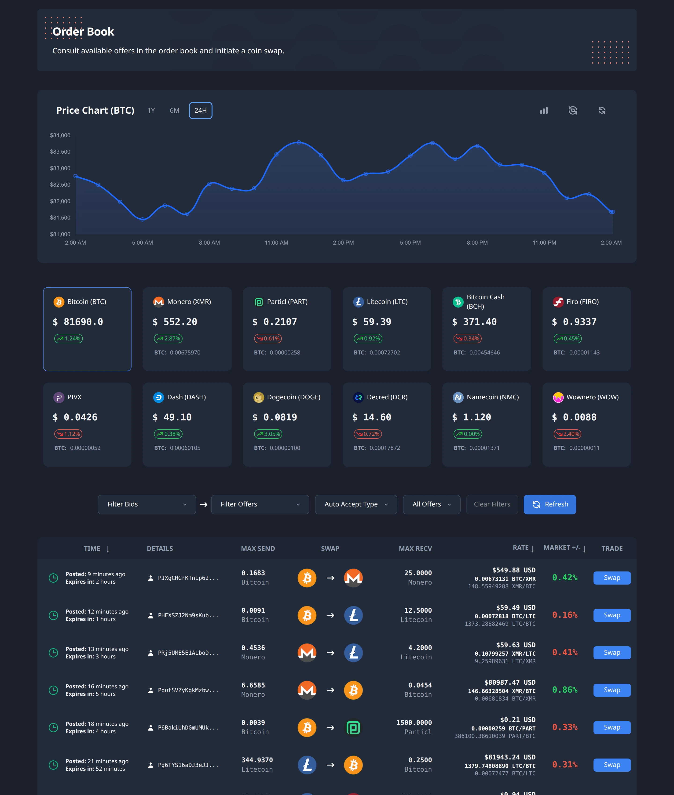
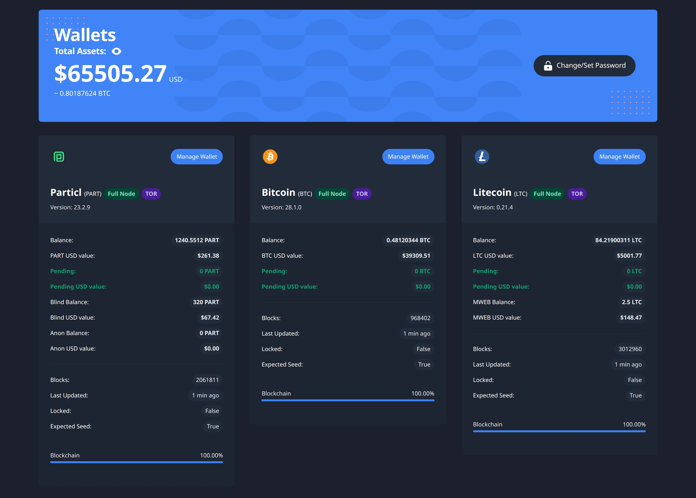

BasicSwap is a decentralized exchange (DEX) that you run on your own computer to trade coins such as Bitcoin, Monero and Litecoin directly with other people. Each trade is an atomic swap, in which both sides lock their coins on their own blockchains and either both payments go through or both sides get their coins back. There's no account to open, no company holding your coins, and no trading fee beyond each blockchain's own network fees.

These docs explain how to [install BasicSwap](/docs/user-guides/install), how to [make](/docs/user-guides/make-offer) and [take](/docs/user-guides/take-offer) offers, and how it works underneath.

## How it works

BasicSwap combines an order book with the software to carry out swaps. Traders post offers, other traders bid on them, and when the offerer accepts a bid, the two BasicSwap apps exchange the keys, addresses and signatures that set up the swap. Nobody else takes part in a trade, and BasicSwap never holds anyone's coins.

Those messages travel over peer-to-peer message networks rather than through a server. BasicSwap can use Particl's SecureMessaging network (SMSG), SimpleX and Nostr, one or several at once, and encrypts every bid and swap message so that only the other trader can read it, as [Message networks](/docs/user-guides/message-networks) describes in more detail.

The swap itself happens on the two blockchains, using one of BasicSwap's two atomic swap protocols. One relies on a shared secret and hash timelocks and suits coins with scripts, such as Bitcoin and Litecoin, while the other relies on adaptor signatures and also works with Monero and Wownero, whose blockchains have no scripts at all. [Under the hood](/docs/about/under-the-hood) explains how each one works.

<Callout type="info" title="Beta software">

BasicSwap is still in beta, although it already has the features a trader needs and people use it for real swaps. It changes from one release to the next, so it's worth reading the [release notes](/blog) before you update.

</Callout>

## What you get

<Cards>
  <Card icon="blocks" title="Swaps across chains">Trade coins on different blockchains, such as Bitcoin for Monero, without wrapped tokens or a bridge.</Card>
  <Card icon="nodes" title="A shared order book">Offers spread between traders over the message networks, so there's no central matching engine to go down or be shut off.</Card>
  <Card icon="userOff" title="Nobody in the middle">You trade with the other person directly, and your coins stay in your own wallets until the swap.</Card>
  <Card icon="percent" title="No trading fees">You pay each blockchain's normal network fees and nothing else.</Card>
  <Card icon="lock" title="Privacy">There's no account or identity check, every message is encrypted, and you can trade Monero and run over Tor.</Card>
  <Card icon="chart" title="A web interface">You manage wallets, offers, bids and swaps in your browser, and scripts can do the same through a JSON API.</Card>
</Cards>

## Supported coins

Particl is always enabled, and you choose which other coins to run. Bitcoin and Litecoin can run as [Electrum light wallets](/docs/user-guides/lightweight-modes), and Monero and Wownero can use a [remote node](/docs/user-guides/lightweight-modes#monero-remote-nodes), so you don't need to download those blockchains, while every other coin runs a full node.

<Tabs>
<TabItem value="bitcoin" label="Bitcoin and forks" default>

- **Bitcoin (BTC)**, the first cryptocurrency, with an optional light wallet
- **Litecoin (LTC)**, a faster Bitcoin derivative with private MWEB transfers, with an optional light wallet
- **Bitcoin Cash (BCH)**, a Bitcoin fork focused on payments
- **Dogecoin (DOGE)**, a Litecoin-derived coin with one-minute blocks
- **Namecoin (NMC)**, a Bitcoin fork that also stores names and DNS records

</TabItem>
<TabItem value="privacy" label="Privacy coins">

- **Monero (XMR)**, private by default, with an optional remote node
- **Wownero (WOW)**, a Monero fork, with an optional remote node
- **Particl (PART)**, with confidential and anonymous balances and the SMSG network
- **Firo (FIRO)**, with private Spark transactions
- **PIVX (PIVX)**, a proof-of-stake coin with shielded transactions

</TabItem>
<TabItem value="other" label="Other coins">

- **Dash (DASH)**, built for fast payments, with optional CoinJoin mixing
- **Decred (DCR)**, with hybrid proof-of-work and proof-of-stake governance

</TabItem>
</Tabs>

[Integrate a coin](/docs/user-guides/integrate-coin) explains what a blockchain needs before BasicSwap can add it.
